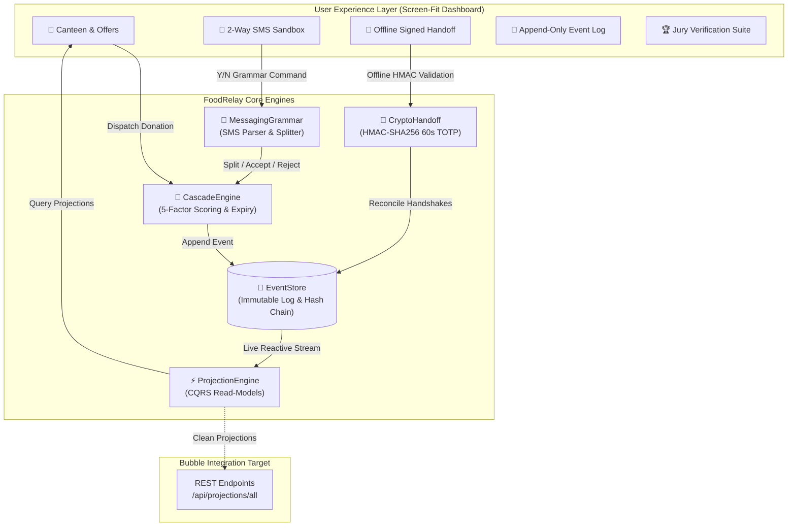

<div align="center">

# 🍱 FoodRelay
### *Urgency-First Food Redistribution Layer*
**Zero Syntax 2026 Hackathon • Team Vayu9**  
*Assigned Twist: "The Cascade & Offline Handoff"*

[](https://foodrelay.onrender.com)
[](https://foodrelay.onrender.com)
[](https://foodrelay.onrender.com)
[](https://foodrelay.onrender.com)
[](https://nodejs.org)

<br/>

> **"Every surplus meal has a countdown. When a partner doesn't reply or internet fails at the canteen door, food cannot wait."**  
> FoodRelay eliminates manual coordination delays through an immutable event-sourced cascade engine, a deterministic two-way messaging grammar, and 100% offline cryptographic handoff verification.

</div>

---

## 🌐 Live Production URL
🔗 **[https://foodrelay.onrender.com](https://foodrelay.onrender.com)**  
*(Screen-fit real-time dashboard with integrated SMS sandbox, offline verifier, event replay benchmark, and 1-click jury test suite).*

---

## 📑 Table of Contents
- [🌟 Executive Summary](#-executive-summary)
- [⚡ The Assigned Twist: 4 Core Architectural Pillars](#-the-assigned-twist-4-core-architectural-pillars)
  - [1. Append-Only Event Log & Replay Projections](#1-append-only-event-log--replay-projections)
  - [2. Cascading Re-Offer Engine with 5-Factor Scoring](#2-cascading-re-offer-engine-with-5-factor-scoring)
  - [3. Two-Way Plain-Text Messaging Grammar & Partial Split](#3-two-way-plain-text-messaging-grammar--partial-split)
  - [4. 60-Second Rotating Offline Cryptographic Handoff](#4-60-second-rotating-offline-cryptographic-handoff)
- [📐 System Architecture & Diagrams](#-system-architecture--diagrams)
- [📊 Impact Scorecard & UNEP Benchmarks](#-impact-scorecard--unep-benchmarks)
- [🏆 Jury Verification Suite (Live Verification)](#-jury-verification-suite-live-verification)
- [🔌 Bubble API Connector Specification](#-bubble-api-connector-specification)
- [💻 Local Development & Setup](#-local-development--setup)
- [👥 Team Vayu9](#-team-vayu9)

---

## 🌟 Executive Summary

Traditional surplus food apps rely on relational databases with mutable rows: an offer is inserted, updated to `ACCEPTED`, or deleted when expired. When networks drop or recipients hesitate, food spoils.

**FoodRelay re-engineers this paradigm:**
1. **Truth is Immutable:** Offer statuses, recipient quotas, and carbon impacts are **pure projections** derived exclusively from an append-only cryptographic event log. Bubble or frontend layers *never store or mutate state directly*.
2. **Self-Healing Cascades:** If an NGO does not claim an offer within a dynamically computed time window, the system automatically expires it and re-offers it to the next optimal recipient—with **zero human intervention**.
3. **Partial Acceptance:** If a kitchen only needs 30 out of 50 meals, it takes 30; the remaining 20 meals automatically cascade to the next shelter in real time.
4. **Zero-Connectivity Handoff:** Volunteer collectors verify handoff authenticity at basement loading docks with **zero cellular/Wi-Fi coverage** using client-side rotating HMAC-SHA256 tokens.

---

## ⚡ The Assigned Twist: 4 Core Architectural Pillars

### 1. Append-Only Event Log & Replay Projections
*Guaranteed: Bubble and external clients hold zero source-of-truth state.*

- **Cryptographic Hash Chaining:** Every log entry (`DONATION_CREATED`, `OFFER_DISPATCHED`, `OFFER_ACCEPTED`, `OFFER_REJECTED`, `OFFER_EXPIRED`, `OFFER_SPLIT`, `DONATION_COLLECTED`) contains a strict SHA-256 `prevHash` pointer matching the previous entry, establishing a tamper-evident blockchain-style audit trail.
- **Microsecond In-Memory Projections:** Replays thousands of events from scratch in under 5 milliseconds to project:
  - Active & historical relay offers
  - Real-time committed vs. reserved pending recipient capacities
  - UNEP impact scorecard (meals, acceptance rate, collection rate, speed, CO₂e)
- **Anti-Double-Allocation Guard:** Atomic reservations in the projection ledger guarantee that recipient capacity cannot be over-allocated even under concurrent donation dispatches.

```
[Genesis Hash: 0000...] ──> [EVT-01: DONATION_CREATED] ──> [EVT-02: OFFER_DISPATCHED] ──> [EVT-03: OFFER_ACCEPTED]
                                  hash: 660476...                hash: 1c9060...                hash: 8df412...
                                  prevHash: 0000...              prevHash: 660476...            prevHash: 1c9060...
```

---

### 2. Cascading Re-Offer Engine with 5-Factor Scoring
*Continuous, automated urgency ranking when partners reject or timeout.*

- **Dynamic Acceptance Window Formula:**  
  $$\text{Window} = \min(10\text{ minutes}, 0.25 \times \text{Remaining Safe Pickup Time})$$
  - *Example A:* 2-Hour batch (120 min) $\rightarrow 0.25 \times 120 = 30\text{ min} \implies \mathbf{10\text{ min}}$ (capped).
  - *Example B:* 20-Minute critical batch $\rightarrow 0.25 \times 20 = \mathbf{5\text{ min}}$ (urgency-adaptive).

- **Explainable 5-Factor Scoring Matrix:**
  $$\text{Score} = 0.35 \times \text{Urgency} + 0.25 \times \text{Proximity} + 0.20 \times \text{Capacity} + 0.15 \times \text{Dietary} + 0.05 \times \text{Reliability}$$

| Factor | Weight | Evaluation Logic |
| :--- | :---: | :--- |
| **Urgency / Safe Time** | **35%** | Scaled against safe pickup expiration threshold |
| **Travel Distance** | **25%** | Haversine distance from donor canteen to verified recipient |
| **Available Capacity** | **20%** | Max capacity minus (committed allocated + reserved pending) |
| **Dietary Compatibility** | **15%** | Exact match (Veg / Non-Veg / Jain food certifications) |
| **Reliability History** | **5%** | Historic collection fulfillment rate |

- **Anti-Repeat Guarantee:** No recipient receives a repeat offer for the same batch or child split.

---

### 3. Two-Way Plain-Text Messaging Grammar & Partial Split
*Zero-app friction: Shelter coordinators respond via basic SMS or WhatsApp.*

The built-in parser evaluates responses strictly against an unambiguous formal grammar:

```
COMMAND     ::= ACCEPT | REJECT
ACCEPT      ::= ("Y" | "YES" | "y") <SPACE> <OFFER_CODE> [<SPACE> <MEALS>]
REJECT      ::= ("N" | "NO" | "n") <SPACE> <OFFER_CODE>
OFFER_CODE  ::= "RELAY-" [0-9]+ ("-" [A-Z]+)?
MEALS       ::= [1-9][0-9]*
```

- **Full Acceptance:** `Y RELAY-420 50` $\rightarrow$ Locks all 50 meals to recipient, emits `OFFER_ACCEPTED`.
- **Immediate Rejection:** `N RELAY-420` $\rightarrow$ Unlocks reservation, triggers immediate cascade to rank #2 recipient.
- **Partial Acceptance & Auto-Split:**
  - Canteen lists **50 meals** (`RELAY-420`).
  - Shelter A has room for only **30 meals** and texts: `Y RELAY-420 30`.
  - System splits batch:
    - Commits 30 meals to Shelter A (`RELAY-420-A`).
    - Emits `OFFER_SPLIT`.
    - Spawns child offer `RELAY-420-B` with remaining 20 meals and **immediately cascades it to the next eligible shelter**!

---

### 4. 60-Second Rotating Offline Cryptographic Handoff
*Guarantees physical proof of collection even when offline in kitchen basements.*

```
Donor Canteen Device (Online or Offline)               Collector / NGO Phone (100% Offline)
┌──────────────────────────────────────────┐          ┌──────────────────────────────────────────┐
│ Generates HMAC-SHA256 Token:             │          │ Cuts mobile data & Wi-Fi to Airplane mode│
│ Payload: FR1.DON-901.RELAY-12.50.T_EPOCH │          │ Scans / inputs token                     │
│ Short PIN: 482-910                       │ ───────> │ Local WebCrypto calculates signature     │
│ 60-Second Rotating Countdown Wheel       │          │ Validates window: |T_now - T_token| <= 60s│
└──────────────────────────────────────────┘          │ Anti-Replay: Blocks duplicated codes    │
                                                      │ Queues record in local offline ledger    │
                                                      └──────────────────────────────────────────┘
                                                                           │
                                                      When Internet returns: Reconnect & Reconcile
                                                      POST /api/handoff/reconcile ──> Event Store
```

- **Rotating Time Windows:** Tokens cycle every 60 seconds ($T = \lfloor \text{Epoch} / 60 \rfloor$), ensuring stale codes cannot be captured or reused.
- **Anti-Replay Ledger:** Consumed code hashes are stamped into both local browser storage and the backend projection ledger.
- **Reconciliation Engine:** Offline collections queue locally and reconcile automatically into the canonical event log when connection restores.

---

## 📐 System Architecture & Diagrams



---

## 📊 Impact Scorecard & UNEP Benchmarks

FoodRelay measures live operational throughput against UNEP pilot sustainability targets:

```
┌─────────────────┬─────────────────┬─────────────────┬─────────────────┬─────────────────┐
│  VOLUME TARGET  │ QUALITY TARGET  │  SPEED TARGET   │COMPLETION TARGET│  CARBON OFFSET  │
│   Target 500+   │   Target ≥70%   │  Target <5 min  │   Target ≥80%   │  UNEP Baseline  │
│       275       │      76.5%      │     2.4 min     │      84.6%      │    522.5 kg     │
│Meals Listed: 425│ Offers Acc: 325 │  Median Accept  │Meals Coll: 275  │CO₂e (1.9kg/meal)│
└─────────────────┴─────────────────┴─────────────────┴─────────────────┴─────────────────┘
```

- **Carbon Offset Formula:** $\text{CO}_2\text{e Saved (kg)} = \text{Meals Rescued} \times 1.9\text{ kg}$ (UNEP standard).
- **Dynamic Counters:** Numbers update smoothly with quartic ease-out animations as events are processed.

---

## 🏆 Jury Verification Suite (Live Verification)

Navigate to **Tab 5 ("🏆 Jury Verification Suite")** on the live demo to run automated, 1-click end-to-end tests:

| Test Scenario | Twist Clause Validated | What It Tests |
| :---: | :--- | :--- |
| **#1** | **Append-Only Replay & Hash Chain** | Replays all events from scratch; validates SHA-256 hash chaining and verifies Bubble maintains zero mutable state. |
| **#2** | **Dynamic Window Formula** | Tests $\min(10\text{m}, 0.25 \times T)$ for a 2-hour donation (10m) and a 20-minute batch (5m). |
| **#3** | **Cascade Engine Auto-Rank** | Simulates SMS rejection; engine automatically re-ranks and dispatches to recipient #2 with 5-factor scoring. |
| **#4** | **Grammar & Partial Split** | Sends `Y RELAY-X 30` for a 50-meal offer; commits 30m, splits remainder, and auto-cascades remaining 20m. |
| **#5** | **Anti-Double-Allocation** | Dispatches concurrent donation batches; proves atomic capacity reservations prevent over-allocation. |
| **#6** | **Offline Handoff & Anti-Replay** | Generates 60s rotating token, cuts network to OFFLINE, validates on device, rejects duplicate code, reconnects & reconciles. |

*(Click **"▶️ Run Full Live Test Suite"** to watch all 6 scenarios execute sequentially with live execution logs).*

---

## 🔌 Bubble API Connector Specification

Bubble interacts with FoodRelay exclusively through clean read-model projections:

| Method | Endpoint | Description | Sample Output |
| :--- | :--- | :--- | :--- |
| `GET` | `/api/projections/all` | Complete read-model for all Bubble pages | `{ offers: [...], recipients: [...], impact: {...} }` |
| `GET` | `/api/projections/offers` | Active & historical offer list | `[{ offerCode: "RELAY-837", status: "OFFERED", ... }]` |
| `GET` | `/api/projections/recipients`| Live remaining & reserved recipient quotas | `[{ name: "Asha Shelter", availableCapacity: 120 }]` |
| `GET` | `/api/projections/impact` | Real-time UNEP impact scorecard | `{ totalMealsCollected: 275, co2SavedKg: 522.5 }` |
| `POST`| `/api/events/replay` | Benchmarked full log replay from scratch | `{ success: true, eventsReplayed: 35, durationMs: 2.1 }` |
| `GET` | `/health` | Cloud platform uptime health-check | `{ status: "ok", uptime: 1420.5 }` |

---

## 💻 Local Development & Setup

### Prerequisites
- Node.js (v18+ recommended, v24 supported)
- npm (v9+)

### Installation
```bash
# 1. Clone repository
git clone https://github.com/PiyushKhurana17/FoodRelay.git
cd FoodRelay

# 2. Install dependencies
npm install

# 3. Configure environment (optional, defaults work out-of-the-box)
cp .env.example .env

# 4. Start server
npm start
```

Visit **`http://localhost:3000`** in your browser.

---

## 👥 Team Vayu9

Built with dedication for **Zero Syntax 2026**:
- **Architecture & Event-Driven Core:** Team Vayu9
- **Twist Implementation:** The Cascade & Offline Handoff
- **Impact Focus:** Zero Food Waste • Zero Delay • Offline Resilience

---

<div align="center">
  <sub>FoodRelay © 2026 • Built for Zero Syntax Hackathon • Open Source MIT License</sub>
</div>
